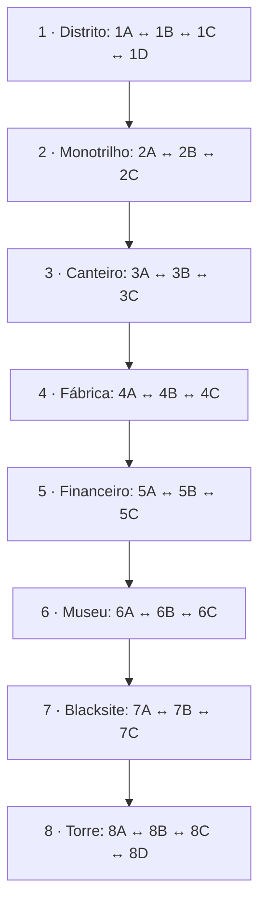

# Campanha, subfases e exploração — contrato atual

Implementação inicial: incremento 4, 13/11/2026. Este documento descreve código executável, não apenas o roteiro editorial.

## Conteúdo disponível

A campanha mantém oito fases principais com **26 mapas próprios**, distribuídos em **4+3+3+3+3+3+3+4**. Não há adaptadores dos mapas originais no catálogo de campanha. Os oito originais continuam acessíveis por botões de teste/API `loadStage()`, fora dessa contagem.

O lote contém 130 inimigos iniciais, 77 checkpoints e 78 objetos de recurso/segredo. Essas quantidades descrevem os dados atuais, não um limite de respawn ou de vidas. A meta de conteúdo foi atingida; balanceamento integral, segredos, música/arte e ensaios físicos continuam em andamento.

| Setor | Identidade | Inimigos iniciais | Pontos de apoio | Papel |
| --- | --- | ---: | ---: | --- |
| 1A | Fuga do Laboratório | 4 | 3 | Aprender portas, exploração superior e primeiros combates |
| 1B | Telhados de Neon | 5 | 3 | Vãos, coberturas, plataformas móveis, sniper e jetpack |
| 1C | Esgotos de Manutenção | 4 | 3 | Ácido, esteira, reservatório e caminhos por canos |
| 1D | Avenida Bloqueada | 5 | 2 | Bloqueio tático e encontro final com Cipher-01 |
| 2A | Vagões e Embarque | 5 | 3 | Acoplamentos entre vagões, vento e compartimentos superiores |
| 2B | Cabos e Manutenção | 5 | 3 | Conduítes, refrigeração, esteira e exploração por cabos |
| 2C | Teto e Pórticos | 5 | 3 | Rasteira contra pórticos, escolta obrigatória e Valkyrie-7 |
| 3A | Fundação da Torre | 5 | 3 | Bases de concreto, vãos e exploração nas vigas |
| 3B | Guindastes e Vigas | 6 | 3 | Subida de mil unidades, patamar intermediário e andaimes opcionais |
| 3C | Heliponto na Tormenta | 5 | 3 | Escolta de demolição e encontro final com Goliath-IV |
| 4A | Tanques de Refrigeração | 5 | 3 | Canais de resíduo, comandos superiores e suprimentos |
| 4B | Linhas de Esteiras | 5 | 3 | Transporte em sentidos opostos e terminais elevados |
| 4C | Núcleo de Descarte | 5 | 3 | Guarda do reator e Arisawa/Cyber-T-Rex |
| 5A | Boulevard de Mármore | 5 | 3 | Barricadas, terraços, carros e agentes executivos |
| 5B | Garagens e Serviços | 5 | 3 | Barreiras laser, elevadores e acesso restrito |
| 5C | Suíte Executiva | 5 | 3 | Escolta do cofre e Castor/Pólux |
| 6A | Galerias Holográficas | 5 | 3 | Sensores, galerias e marquises |
| 6B | Jardins Digitais | 5 | 3 | Canais e passarelas sob cerejeiras holográficas |
| 6C | Acervo Restrito | 5 | 3 | Escolta dos arquivos e Kusanagi |
| 7A | Docas de Blacksite | 5 | 3 | Vãos, vento e postos de vigilância |
| 7B | Blocos de Contenção | 5 | 3 | Sensores, elevadores e passagem para o comando |
| 7C | Centro de Comando | 5 | 3 | Guarda de comando e Vane |
| 8A | Base da Torre | 5 | 3 | Segurança da torre em gravidade normal |
| 8B | Núcleo Zero | 5 | 3 | Transportadores e gravidade 0,85 |
| 8C | Elevador Orbital | 6 | 3 | Subida de 900 unidades em gravidade 0,72 |
| 8D | Estratosfera | 5 | 3 | Última escolta, gravidade 0,65 e Oswald/Entidade Zero |

O grafo de portas só liga áreas da mesma fase principal. Avançar para a fase principal seguinte é uma transição de campanha após conclusão, não uma porta livre.

## Arquivos e contratos

- `src/game/campaign/types.ts`: `CampaignStage`, `SubstageDefinition`, `CheckpointDefinition`, `ExitDefinition`, `PlayerCarry` e `CampaignProgress`.
- `src/game/campaign/museum.ts`, `blacksite.ts` e `tower.ts`: dez mapas finais; a torre tem gravidade progressiva e uma subida de 900 unidades no eixo orbital.
- `src/game/campaign/factory.ts` e `financial.ts`: seis mapas das fases 4/5, com portas de retorno e arenas/chefes somente no último setor. `authoring.ts` compartilha valores de autoria dos novos mapas, sem alterar os capítulos já existentes.
- `src/game/campaign/construction.ts`: três mapas do canteiro; o núcleo em degraus sobe de Y=1040 para Y=40, com câmera limitada ao setor e checkpoints no meio/topo.
- `src/game/campaign/monorail.ts`: três mapas do monotrilho, com arena e chefe apenas no setor final.
- `src/game/campaign/district.ts`: os quatro mapas do distrito. Paleta/música temática são reaproveitadas; geometria e arrays de encontros são novos.
- `src/game/campaign/index.ts`: catálogo executável, adaptador dos mapas antigos, resolução de IDs e validação.
- `GameEngine.startCampaign()`: começa uma tentativa na entrada da fase principal.
- `GameEngine.loadStage()`: API de compatibilidade para os mapas originais, sem navegação entre áreas.
- `GameEngine.travel()`: aplica uma porta válida próxima ao personagem e preserva recursos/estado da sessão.
- `GameEngine.getCampaignProgress()`: retorna uma cópia da identificação de fase, setor, checkpoint, áreas visitadas e recursos do jogador. É contrato resumido de sessão. O save completo é produzido por `captureCampaignSave()` e validado/restaurado por `restoreCampaignSave()`; ver `SALVAMENTO.md`.

IDs de subfase são estáveis, como `1A`. Um spawn usa namespace da subfase, por exemplo `1B:3`; seu identificador de entidade muda a cada aparição. Objetos podem reutilizar números em subfases diferentes porque o estado é separado por área.

## Portas e entrada

A interação é **CIMA**: seta/W no teclado, botão superior do direcional de toque ou analógico/D-pad para cima. O evento de interação entra na fila do tick; um toque curto não se perde quando o jogador solta o botão antes da próxima atualização.

É necessário estar dentro da região da porta. Segurar cima sem uma nova interação não atravessa automaticamente. As posições de chegada ficam afastadas da porta de retorno, evitando ida e volta involuntária. Estado de entrada é limpo na transição.

Uma arena obrigatória ativa ou um chefe em combate bloqueia a saída. O chefe da avenida espera a arena obrigatória ser concluída antes de ativar seu encontro. Cipher-01 em 1D conclui a fase 1; Valkyrie-7 em 2C conclui a fase 2. Goliath-IV em 3C conclui a fase 3. Arisawa em 4C conclui a fase 4; os Gêmeos em 5C concluem a fase 5. Kusanagi em 6C, Vane em 7C e Oswald em 8D fecham os últimos capítulos. Os oito encontros finais aguardam suas escoltas obrigatórias e usam as sequências de [CHEFES.md](CHEFES.md). Pórticos móveis estão habilitados em 2C, com aviso e desvio por rasteira; 2A/2B não usam esse perigo. Sair de um setor intermediário não concede bônus de conclusão nem dispara vitória.

## Estado preservado nas transições

| Estado | Regra |
| --- | --- |
| Herói | Mantém o mesmo; porta nunca troca personagem |
| HP, foco e vidas | Mantém os valores correntes; atravessar porta não cura |
| Pontos e próximo limiar de vida | Preserva internamente, sem números na interface |
| WAV e buffs ATK/JMP/GST | Preserva munição e tempo restante |
| Objetos destruídos e baús abertos | Permanecem abertos no retorno |
| Pickups no chão | Permanecem no estado em que a área foi deixada |
| Inimigos vivos e seu HP | Permanecem na área; não são duplicados nem reiniciados |
| Histórico de derrotas/recompensas | Mantém a curva 1.000 → 500 → 50 → 0 por origem |
| Arenas concluídas | Permanecem concluídas, sem novo bloqueio obrigatório |
| Projéteis, cut-ins e efeitos de assistência | Transientes são descartados ao mudar de área |
| Posição de chegada | Usa checkpoint especificado pela porta; recebe proteção breve |

A área fora de atividade conserva seu estado de simulação. O tempo **simulado em outra área** conta para afastamento/cooldown de inimigos mortos. Tempo no menu/pausa não conta. Ao retornar, a área é repovoada antes do primeiro desenho, somente para inimigos já elegíveis, respeitando cooldown, distância de segurança, ocupação e limite de população. Isso não é aparição dentro de uma câmera já exibida: os inimigos estão presentes quando o setor é revelado. Durante a exploração normal, o raio de preparação se adapta à viewport e a regra de não surgir visivelmente permanece ativa. Inimigos vivos não são substituídos por um spawn novo.

O cache é reiniciado ao começar outra tentativa/fase principal. Não existe farm de baú por atravessar uma porta repetidamente. A troca livre segue disponível somente como ferramenta de teste; no perfil final ela está bloqueada, enquanto o continue permite escolher outro herói sem apagar a exploração corrente.

## Checkpoints, recuperação e retomada

Bandeiras marcam pontos de apoio. Aproximar-se andando ativa o ponto e mostra uma confirmação. Ao perder uma vida ou usar continue, a campanha retorna ao ponto de apoio ativado na subfase corrente, com a posição de piso revalidada. Uma queda não fatal continua usando o resgate para o piso seguro, sem apagar a área.

**Reiniciar Fase** começa novamente a fase principal, voltando ao seu primeiro setor e reinicializando a tentativa. **Retomar exploração** no menu mantém a sessão atual: não é reinício e não recria objetos/inimigos.

A retomada exata funciona enquanto a sessão está aberta. O incremento 7 acrescenta **Carregar campanha salva** depois de recarregar/fechar: restaura no ponto de apoio com recursos, objetos, inimigos e histórico de recompensas, validando todo o arquivo antes de alterar o motor. Emboscadas em andamento rearmam ao chegar ao gatilho e chefes não concluídos reiniciam o confronto; conclusão e game over permanecem como tais. Ver [SALVAMENTO.md](SALVAMENTO.md) para política, formato, recuperação e limites.

## Validação e limites

`validateCampaign()` roda na carga dos dados e nos testes. Rejeita IDs duplicados, filiação incorreta, geometrias inválidas, checkpoints obstruídos/fora do mapa, portas sem destino/checkpoint, setores inalcançáveis e fases sem exatamente um encontro final. A soma editorial de 26 setores é verificada separadamente da quantidade já construída.

A geometria principal dos 26 setores foi atravessada por simulação para os três heróis, sem voo/teletransporte, sem resgate de abismo e sem contato com ácido ou dependência de imunidade. Nos capítulos 2–8, a volta também foi verificada em cada setor com os três heróis. Os lasers de 5B fazem parte das rotas testadas, sem depender de invulnerabilidade. Os testes de rota isolam combate/arena/pórticos (esses possuem teste próprio) para avaliar deslocamento; não representam uma certificação de dificuldade de todos os confrontos ou segredos. Há testes separados para bloqueios, derrota final, morte/continue e preservação de estado.

Os cenários continuam usando a arte provisória e o sistema sonoro existente. Polimento de encontros e segredos e validação Android/DualShock 4 físico continuam pendentes. Nenhuma Action automática ou geração de APK faz parte desta etapa.

## Compatibilidade do incremento 10

A expansão substitui o antigo adaptador de 3A pelos novos mapas 3A/3B/3C. Saves de fases 1/2 preservam a identificação de conteúdo; saves da fase 3 original são apresentados como incompatíveis e ficam retidos para descarte/substituição explícita. Não existe migração automática entre geometrias diferentes. O mapa original continua acessível para testes, sem substituir o save de campanha. A máquina de estados completa da IA, aprimoramento dos chefes, arte e trilha novas continuam nas respectivas etapas do plano.

## Compatibilidade do incremento 12

A expansão das fases 4/5 mantém a identificação de conteúdo dos capítulos 1–3. Saves das versões originais de 4A/5A ficam incompatíveis com as novas geometrias e são retidos para descarte/substituição explícita, sem migração silenciosa. A IA tem leitura compatível do campo opcional `Enemy.ai`, conforme [IA_E_COMBATE.md](IA_E_COMBATE.md). Os perfis de chefes ainda são os existentes; o trabalho nos mapas não equivale a concluir suas mecânicas futuras.

## Incremento 14 — catálogo completo

Museu e Blacksite têm três setores cada; a torre tem quatro. Só o último setor de cada capítulo possui chefe. A cadeia inteira é alcançável por portas de ida/volta, e os oito capítulos têm exatamente um encontro final. Os testes de geometria incluem lasers, vento e gravidade por setor, sem voo, dano ou resgate como atalho. A restauração foi exercitada em uma instância nova do motor para cada um dos 26 setores.

Na torre, a gravidade passa de 1 em 8A para 0,85/0,72/0,65. O nome Elevador Orbital descreve o eixo da subida: o percurso principal é escalável por degraus e há plataformas móveis opcionais, não um elevador automático que carregue o jogador sem comandos. O checkpoint intermediário e a câmera vertical foram verificados.

Saves dos capítulos 1–5 mantêm sua identificação de conteúdo. Os saves das versões originais de 6–8 são retidos como incompatíveis com as novas geometrias, sem migração silenciosa. Formato continua versão 1. Vitória final/carregamento persistente não repete a recompensa nem ressuscita o chefe.

Chegar a 26 mapas não encerra a produção: dificuldade, rotas de segredo, acessibilidade, arte, áudio e teste físico seguem os aceites do plano. Os ensaios de fluxo final usam derrota disparada em teste para validar diálogos/interface/save; não representam uma campanha inteira vencida em tempo real.

Incremento 15: os encontros industriais de 4A/4B/7A/7B incluem suportes de parede/teto e instaladores. Total atual: 132 inimigos inicialmente ativos e duas origens filhas dormentes; continuam 26 setores, 77 checkpoints e 78 objetos. Ver [TORRETAS_E_PROJETEIS.md](TORRETAS_E_PROJETEIS.md).

Incremento 18: a travessia dos 23 setores fora do trem agora inclui alas obrigatórias e retorno; saídas/confrontos são condicionados ao circuito, com portões persistentes. Há seis depósitos laterais opcionais. Catálogo atual: 155 inimigos inicialmente ativos e duas origens dormentes, 77 checkpoints/78 objetos. Padrão, mapas e aceite físico em [PADRAO_DE_FASES.md](PADRAO_DE_FASES.md).
