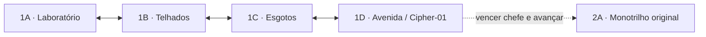

# Campanha, subfases e exploração — contrato atual

Implementação inicial: incremento 4, 13/11/2026. Este documento descreve código executável, não apenas o roteiro editorial.

## Conteúdo disponível

A campanha mantém oito fases principais. O distrito agora tem quatro mapas novos, com geometria, encontros, objetos e checkpoints próprios. As fases 2–8 continuam usando seus sete mapas originais por meio de adaptadores. Portanto, existem **11 mapas na campanha atual**; a meta editorial continua em 26. O mapa original do distrito permanece acessível pelo botão de teste e pela API `loadStage()`, fora da contagem dos 11.

| Setor | Identidade | Inimigos iniciais | Pontos de apoio | Papel |
| --- | --- | ---: | ---: | --- |
| 1A | Fuga do Laboratório | 4 | 3 | Aprender portas, exploração superior e primeiros combates |
| 1B | Telhados de Neon | 5 | 3 | Vãos, coberturas, plataformas móveis, sniper e jetpack |
| 1C | Esgotos de Manutenção | 4 | 3 | Ácido, esteira, reservatório e caminhos por canos |
| 1D | Avenida Bloqueada | 5 | 2 | Bloqueio tático e encontro final com Cipher-01 |

O grafo de portas só liga áreas da mesma fase principal. Avançar para a fase principal seguinte é uma transição de campanha após conclusão, não uma porta livre.

## Arquivos e contratos

- `src/game/campaign/types.ts`: `CampaignStage`, `SubstageDefinition`, `CheckpointDefinition`, `ExitDefinition`, `PlayerCarry` e `CampaignProgress`.
- `src/game/campaign/district.ts`: os quatro mapas do distrito. Paleta/música temática são reaproveitadas; geometria e arrays de encontros são novos.
- `src/game/campaign/index.ts`: catálogo executável, adaptador dos mapas antigos, resolução de IDs e validação.
- `GameEngine.startCampaign()`: começa uma tentativa na entrada da fase principal.
- `GameEngine.loadStage()`: API de compatibilidade para os mapas originais, sem navegação entre áreas.
- `GameEngine.travel()`: aplica uma porta válida próxima ao personagem e preserva recursos/estado da sessão.
- `GameEngine.getCampaignProgress()`: retorna uma cópia da identificação de fase, setor, checkpoint, áreas visitadas e recursos do jogador. É contrato de sessão em memória, não um save em disco.

IDs de subfase são estáveis, como `1A`. Um spawn usa namespace da subfase, por exemplo `1B:3`; seu identificador de entidade muda a cada aparição. Objetos podem reutilizar números em subfases diferentes porque o estado é separado por área.

## Portas e entrada

A interação é **CIMA**: seta/W no teclado, botão superior do direcional de toque ou analógico/D-pad para cima. O evento de interação entra na fila do tick; um toque curto não se perde quando o jogador solta o botão antes da próxima atualização.

É necessário estar dentro da região da porta. Segurar cima sem uma nova interação não atravessa automaticamente. As posições de chegada ficam afastadas da porta de retorno, evitando ida e volta involuntária. Estado de entrada é limpo na transição.

Uma arena obrigatória ativa ou um chefe em combate bloqueia a saída. O chefe da avenida espera a arena obrigatória ser concluída antes de ativar seu encontro. Somente Cipher-01 em 1D conclui a fase 1; sair de 1A, 1B ou 1C não concede bônus de conclusão nem dispara vitória.

## Estado preservado nas transições

| Estado | Regra |
| --- | --- |
| Herói | Mantém o mesmo; porta nunca troca personagem |
| HP, foco e vidas | Mantém os valores correntes; atravessar porta não cura |
| Pontos e próximo limiar de vida | Preserva internamente, sem números na interface |
| WAV e buffs ATK/JMP/GST | Preserva munição e tempo restante |
| Objetos destruídos e baús abertos | Permanecem abertos no retorno |
| Pickups no chão | Permanecem no estado em que a área foi deixada |
| Inimigos vivos e seu HP | Permanecem na área; não são duplicados nem reiniciados |
| Histórico de derrotas/recompensas | Mantém a curva 1.000 → 500 → 50 → 0 por origem |
| Arenas concluídas | Permanecem concluídas, sem novo bloqueio obrigatório |
| Projéteis, cut-ins e efeitos de assistência | Transientes são descartados ao mudar de área |
| Posição de chegada | Usa checkpoint especificado pela porta; recebe proteção breve |

A área fora de atividade conserva seu estado de simulação. O tempo **simulado em outra área** conta para afastamento/cooldown de inimigos mortos. Tempo no menu/pausa não conta. Ao retornar, a área é repovoada antes do primeiro desenho, somente para inimigos já elegíveis, respeitando cooldown, distância de segurança, ocupação e limite de população. Isso não é aparição dentro de uma câmera já exibida: os inimigos estão presentes quando o setor é revelado. Durante a exploração normal, o raio de preparação se adapta à viewport e a regra de não surgir visivelmente permanece ativa. Inimigos vivos não são substituídos por um spawn novo.

O cache é reiniciado ao começar outra tentativa/fase principal. Não existe farm de baú por atravessar uma porta repetidamente. A troca livre segue disponível somente como ferramenta de teste; no perfil final ela está bloqueada, enquanto o continue permite escolher outro herói sem apagar a exploração corrente.

## Checkpoints, recuperação e retomada

Bandeiras marcam pontos de apoio. Aproximar-se andando ativa o ponto e mostra uma confirmação. Ao perder uma vida ou usar continue, a campanha retorna ao ponto de apoio ativado na subfase corrente, com a posição de piso revalidada. Uma queda não fatal continua usando o resgate para o piso seguro, sem apagar a área.

**Reiniciar Fase** começa novamente a fase principal, voltando ao seu primeiro setor e reinicializando a tentativa. **Retomar exploração** no menu mantém a sessão atual: não é reinício e não recria objetos/inimigos.

A retomada atual funciona apenas enquanto a página/processo continua aberto. **Recarregar ou fechar a página ainda não salva a campanha.** O formato versionado, a validação de dados armazenados e a restauração persistente continuam na etapa 4.3; um simples ID de checkpoint não preservaria corretamente baús e recompensas e por isso não foi usado como substituto de um save completo.

## Validação e limites

`validateCampaign()` roda na carga dos dados e nos testes. Rejeita IDs duplicados, filiação incorreta, geometrias inválidas, checkpoints obstruídos/fora do mapa, portas sem destino/checkpoint, setores inalcançáveis e fases sem exatamente um encontro final. A soma editorial de 26 setores é verificada separadamente da quantidade já construída.

A geometria principal de 1A–1D foi atravessada por simulação para os três heróis, sem voo/teletransporte, sem resgate de abismo e sem contato com ácido ou dependência de imunidade. Os testes de rota isolam combate/arena para avaliar deslocamento; não representam uma certificação de dificuldade de todos os confrontos ou segredos. Há testes separados para bloqueios, derrota final, morte/continue e preservação de estado.

Os cenários continuam usando a arte provisória e o sistema sonoro existente. Salvamento persistente, produção das demais subfases, polimento de encontros e validação Android/DualShock 4 físico continuam pendentes. Nenhuma Action automática ou geração de APK faz parte desta etapa.
