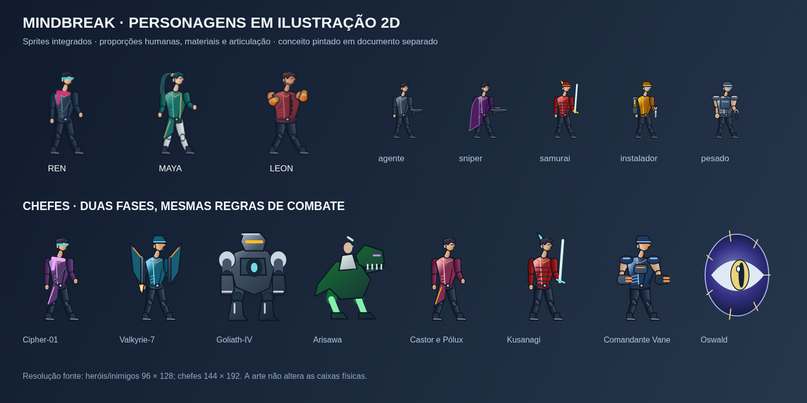

# Direção visual V2 — anatomia, ilustração e identidade

## 1. Revisão solicitada

O usuário pediu formas mais humanas, menos aparência de bonecos em blocos e liberdade para ampliar resolução/estilo. A primeira passagem dos incrementos 20–22 tinha cabeças/troncos retangulares e membros quase uniformes. A V2 substitui essa construção nos sprites integrados por ilustração 2D rasterizada de curvas, articulações e volumes afunilados.

A mudança abrange **três heróis, 12 arquétipos inimigos e os oito encontros de chefe**, incluindo Pólux e duas fases dos chefes. Não foi limitada a aumentar o PNG antigo ou aplicar suavização sobre os blocos.



## 2. Conceito expandido

[Prancha de conceito pintado](arte/conceitos/mindbreak-direcao-humana.png), produzida com a ferramenta de geração de imagens da OpenAI nesta revisão. Prompt original para MindBreak: humanos adultos com proporções naturais, cyberpunk de ação 2D, roupas práticas, faces expressivas e materiais detalhados; sem referência a obras/personagens de terceiros. A prancha tem anotações ilustrativas em inglês.

Ela define a referência para acabamento e produção de poses ilustradas. Os sprites integrados usam o renderer procedural descrito abaixo e sua primeira revisão anatômica. A prancha não é uma spritesheet pronta, nem cada pose do jogo já recebeu pintura manual equivalente. Próximas passagens podem aproximar o acabamento dos sprites dessa referência, com revisão de consistência e custo em aparelho.

- **Ren:** corpo ágil, cabelo escuro, visor estreito com nariz/mandíbula visíveis, jaqueta tática em camadas, faixa/cachecol magenta, calça afunilada e lâmina psíquica fina.
- **Maya:** lutadora atlética, cabelo preso verde-petróleo, casaco técnico com abas e detalhes dourados, calça clara articulada e energia nas mãos. Roupa prática e silhueta própria.
- **Leon:** porte largo, cabelo castanho-avermelhado/barba, colete sem mangas vermelho, manoplas mecânicas laranja e postura de guarda mais pesada.
- **Inimigos:** conservar reconhecimento por equipamento e postura: guarda marcial, capa/rifle do sniper, ferramenta/mochila do instalador, capacetes e escudos condicionais.
- **Chefes:** proporções humanas para personagens humanos; Goliath continua mecha, Arisawa com Cyber-T-Rex, e Entidade Zero com corpo/olho cósmico. Humanizar não significa transformar máquinas/criaturas em pessoas.

## 3. Linguagem gráfica implantada

### 3.1 Anatomia e movimento

`illustratedFigure.ts` define um rig em 48 × 64 unidades de desenho: cabeça, tórax, quadril, cotovelos, mãos, joelhos e pés. A cintura é mais estreita que os ombros. Cabeça/rosto usam curvas e mandíbula; o pescoço é curto, com conexão ao tórax e clavículas. Braços/pernas variam espessura entre músculo, articulação e extremidade. Ombros, mãos, joelhos e botas deixam de ser retângulos equivalentes.

Existem perfis esguio, atlético e pesado. Heróis têm guardas próprias; corrida alterna membros, salto dobra joelhos, escalada alcança a parede, hang eleva braços e ataques estendem a mão conforme a pose. Preservam-se os 18 clipes/55 posições de quadro de cada herói. Estados compartilhados ainda reutilizam componentes; esse sistema não substitui uma animação desenhada individualmente quadro a quadro.

### 3.2 Materiais e equipamentos

O bake usa Canvas 2D com Bézier, polígonos, elipses e gradientes, antialias e amostragem suave. Face, tecido, costuras, cinto, abas, alças, joelheiras e brilho metálico têm tratamento separado. A paleta anterior de poucos símbolos foi substituída por cores-base com variações contínuas de luz/sombra.

`illustratedEquipment.ts` desenha equipamentos e as famílias não humanas: cão mecânico, drone, torreta, mecha, Cyber-T-Rex e olho cósmico. São fontes de código editáveis e reproduzíveis. Garras do mutante, lâmina/armadura do samurai e os dois canhões de Vane preservam papéis visuais. Suportes/mira de torreta, escudos, avisos, partículas e projéteis continuam camadas dinâmicas do motor.

### 3.3 Resolução, formato e escala

| Família | Quadro anterior | Quadro V2 | Área fonte |
|---|---|---|---:|
| Heróis | 24 × 32 | **96 × 128** | 16× |
| Inimigos | 24 × 32 | **96 × 128** | 16× |
| Chefes | 48 × 64 | **144 × 192** | 9× |

“Mais bits” não é sozinho uma medida de qualidade: o formato Canvas/PNG continua RGBA de oito bits por canal, enquanto a resolução, variedade tonal e construção do desenho aumentaram. Nenhum recurso HDR ou mudança de engine foi introduzido.

Heróis: atlas 768 × 896, pivot fonte `(48,128)`, escala de desenho **0,5**, saída **48 × 64 unidades de mundo**. Referência física em pé `(16,16,64,112)` na fonte, equivalente aos mesmos 32 × 56 físicos. Armas/corpos não alteram dano por mudarem de imagem.

Inimigos: fonte completa `(0,0,96,128)`, ajustada a `en.w/h`; o recorte especial da V1 foi substituído por desenhos que ocupam a área atual. Atlas documental 384 × 1536. Chefes: 576 × 3456, 18 linhas, mantendo duas fases/quatro estados e variante de Pólux. Metadados dos três catálogos passam a **versão 2**. Isso é versão de arte, não migração de save.

O pipeline mantém cache sob demanda, sem gerar curvas/gradientes durante cada draw. Orçamento bruto máximo das combinações atuais:

| Cache | RGBA aproximado |
|---|---:|
| Três atlas de heróis | 7,875 MiB |
| 48 quadros inimigos | 2,25 MiB |
| 72 quadros de chefes | 7,594 MiB |
| Total | **17,72 MiB** |

São contas dos pixels, sem overhead de canvas, cópias de GPU ou imagens de interface. A expansão aumenta memória frente à V1; medir em Android continua obrigatório antes da aprovação final. Prancha, PNGs de documentação e galeria não entram no bundle/APK; o jogo usa o código de bake. O tamanho de fonte maior melhora contorno/detalhe, mas o zoom/tamanho físico do jogo continua o mesmo.

## 4. Autoria e inspeção

- [Visão geral integrada](arte/identidade-v2.png) e [captura do ensaio no jogo](arte/jogo-v2.png).
- Heróis: [Ren](arte/ren-sheet.png), [Maya](arte/maya-sheet.png), [Leon](arte/leon-sheet.png).
- [Inimigos: fonte](arte/inimigos-sheet.png) e [renderizador com overlays](arte/inimigos-motor.png).
- [Chefes e duas fases](arte/chefes-sheet.png).
- [Relatório dos 285 recortes/quadros](arte/validacao-v2.json).

Abrir `/tools/art-studio.html` no servidor Vite: animar/inspecionar herói, visualizar referência física e baixar atlas; galerias inimigas/chefes usam as fontes atuais.

Exportar, com Vite aberto e Playwright/Chromium disponíveis:

```bash
PREVIEW_URL=http://localhost:3000 \
PLAYWRIGHT_MODULE=/caminho/playwright/index.mjs \
CHROMIUM_PATH=/usr/bin/chromium \
node scripts/export-art-previews.mjs

PREVIEW_URL=http://localhost:3000 \
PLAYWRIGHT_MODULE=/caminho/playwright/index.mjs \
CHROMIUM_PATH=/usr/bin/chromium \
node scripts/check-art-renders.mjs
```

As variáveis de ferramentas são opcionais quando instaladas no ambiente padrão. O segundo comando verifica os rasters reais, cache, sinal/cores, diferenças entre fases, exporta a visão geral e o relatório. Hashes no relatório são evidência da execução, sem comparação rígida entre plataformas: antialias pode variar por browser/SO.

A prancha gerada por IA é preservada em `docs/arte/conceitos`, separada das fontes usadas pelo motor. Nenhuma Action foi criada/disparada para autoria.

## 5. Validação e limites

400 testes aprovados: física/campanha/combate/áudio existentes mais contratos de atlas, anatomia/rig, poses, estados e imutabilidade. Os testes de matrizes de caracteres/paletas da V1 foram substituídos por verificações pertinentes ao pipeline novo, mantendo a contagem total; não se afirma aumento artificial da suíte.

No Chromium horizontal com touch, os três heróis renderizaram corrida/salto/ataque, pausa e hitstop; inimigos passaram por 48 combinações, quatro suportes e quebra de escudo; chefes por 64 combinações e oito transições reais de fase por dano, incluindo o segundo corpo dos gêmeos. Ensaio com posições/estados preparados, sem erros JavaScript. O comando de autoria também verificou **285** recortes (165 heróis + 48 inimigos + 72 chefes), presença de desenho/variação tonal e cache.

TypeScript, build web, build de assets Android e Capacitor sync aprovados. Bundle JS 473,15 kB / 146,40 kB gzip no fechamento. Nenhum APK ou execução de Action.

Permanecem: revisão artística no aparelho, proporção visual versus área atingível, leitura sob partículas/fundos, custo de primeiro bake e memória/GPU em Android, rostos/expressões mais ricos, poses específicas de cada ataque e acabamento próximo ao conceito pintado. Retratos/cut-ins e cenários continuam etapas do plano. Física, colisão, alcance, timings de combate, música, exploração, recompensas e troca de personagem não foram redesenhados neste lote.
