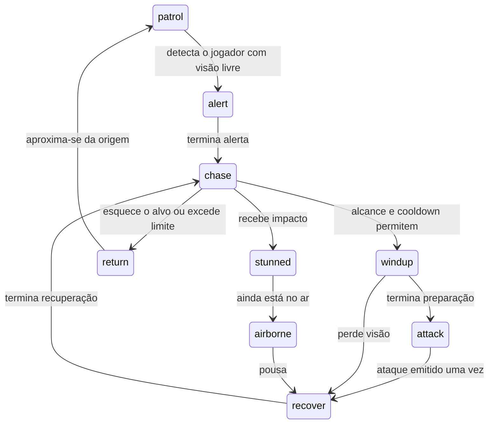

# IA e leitura do combate — incremento 11

## Estados dos inimigos comuns

`src/game/enemyAI.ts` controla os doze arquétipos usando estados explícitos: `patrol`, `alert`, `chase`, `windup`, `attack`, `recover`, `stunned`, `airborne`, `return` e `dead`. O módulo escolhe intenções; o motor aplica movimento, tiros e dano. Integração do terreno continua em `groundActors.ts`.

Alerta inicial de 12 ticks; memória do último ponto visto por até 90 ticks. Esconder-se não atualiza a posição perseguida. Guardas e cães patrulham dentro da faixa de origem com verificação de piso; atiradores mantêm seus postos. O retorno ao limite da origem é contínuo, sem teletransporte.

A preparação trava direção e destino do ataque. O jogador pode desviar, passar pelas costas ou interromper com dano. `attack` emite um único evento e a recuperação oferece uma janela de resposta. O alerta tem indicador `!`; a preparação conserva o destaque visual existente. Ticks são passos da simulação a 60 Hz, não frames do monitor.

| Arquétipo | Preparação | Recuperação | Dano base |
| --- | ---: | ---: | ---: |
| Gunner | 24 | 72 | 11 |
| Sniper | 36 | 90 | 18 |
| Turret | 20 | 54 | 11 |
| Drone | 24 | 70 | 12 |
| Jetpack | 24 | 56 | 12 |
| Mutant | 22 | 44 | 13 |
| Guarda com escudo | 24 | 48 | 12 |
| Cão | 18 | 36 | 13 |
| Suit martial | 16 | 40 | 13 |
| Samurai | 24 | 42 | 16 |
| Heavy trooper | 30 | 48 | 18 |

Os cooldowns iniciais dos mapas continuam respeitados. Os valores acima são ajuste inicial com testes, não balanceamento certificado em aparelho.

## Cooperação, dano e terreno

- Guarda intacto mantém atraso de giro e não inicia ataque para trás antes de virar. Preparação e recuperação não viram instantaneamente para acompanhar o jogador.
- Cão pode preparar flanco quando há um guarda engajado, mas exige piso no destino e respeito ao limite da origem. A preparação também pode ser interrompida.
- Cobertura do gunner pode antecipar o cooldown inicial ao ver o jogador atordoado, sem remover preparação ou recuperação.
- O empurrão do guarda só aplica stun depois de um dano aceito: dash, invulnerabilidade e camuflagem não recebem stun por fora da proteção. Duração: 24 ticks; proteção contra novo stun: 90 ticks. Respawn/recuperação também oferecem proteção. Dano posterior ainda obedece à invulnerabilidade normal.
- Visão é bloqueada por sólidos. Projéteis de ambos os lados calculam contato com terreno por varredura e só atingem atores antes da primeira parede. WAV atravessa inimigos, mas para em parede. Camuflagem não desativa a colisão dos tiros com o mundo.
- Interrupção de contato dos drones exige dano aceito. Os inimigos comuns têm estado próprio; os chefes ainda usam o sistema separado e não são apresentados como convertidos para esta IA.

## Saves e testes

`Enemy.ai` contém estado, tempo, memória, mira, direção e ação. O save versão 1 aceita inimigos antigos sem esse campo. O decodificador valida o novo objeto antes de restaurar. Preparação/ataque em andamento viram recuperação ao carregar no checkpoint, evitando tiro surpresa mirando a posição anterior. HP, identidades, histórico de derrotas e recompensas continuam preservados; a mudança de IA não altera os identificadores de conteúdo dos mapas existentes.

177 testes passaram no fechamento do bloco, incluindo os onze arquétipos, mira travada, perda de alvo, interrupção, recuperação, cooperação, giro do guarda, proteção contra stun, colisão/ordem de contato dos projéteis e leitura de saves antigos. TypeScript, build e smoke de navegação/carregamento em Chromium passaram. A dificuldade de cada encontro, chefes e controles físicos continuam em avaliação nas etapas próprias.

Na integração do incremento 12, a patrulha passou a inverter a direção ao encontrar borda/parede. Inimigos aéreos sem alvo voltam à altura de origem, e o fim da recuperação readquire a posição visível antes de preparar outro ataque. Há testes de regressão para os três casos. A suíte de contato com parede considera que o ator pode se afastar depois de encostar, em vez de exigir que permaneça preso nela.

No incremento 15 foram acrescentados instalador, torretas montadas e rajadas, com exceções explícitas de projéteis. As regras atuais, tempos e compatibilidade estão em [TORRETAS_E_PROJETEIS.md](TORRETAS_E_PROJETEIS.md). Os valores de recuperação da torreta incluem dois tiros adicionais no início; depois há a janela livre. Nenhum tiro atual atravessa sólidos; o Olho Cósmico não pode ser rebatido.

Incremento 16: golpes do jogador agora têm sequência 0/1/2, janela/buffer/recuperação e linha de visão por sólidos, inclusive contra chefes e ao rebater tiros. Ver [COMBOS_E_AUDIO.md](COMBOS_E_AUDIO.md).
