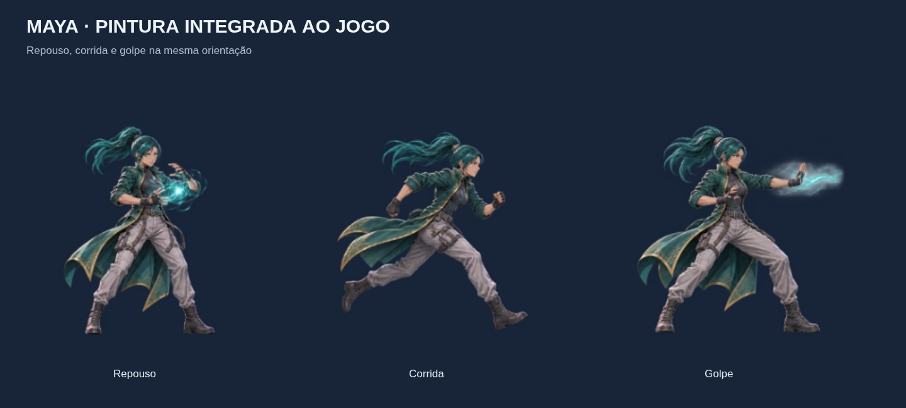

# Maya pintada e orientação do Ren — incremento 25

## 1. Correção da orientação

O usuário percebeu Ren olhando para um lado e virando durante o ataque. A revisão da fonte confirmou que **o repouso foi pintado olhando para a esquerda**, enquanto corrida e cortes olham para a direita. A recuperação usa a pintura de repouso, tornando a inversão aparente ao fim do golpe.

A montagem agora normaliza a fonte para uma orientação canônica à direita: `renSourceFacing('idle') = -1`; as demais fontes mantêm `+1`. O flip é aplicado **no bake, em torno do pivot**, incluindo os slots de recuperação que reutilizam idle. O renderer continua usando `player.facing` uma única vez e a física não muda. Não se inverteu o herói inteiro, o que estragaria as poses que já estavam certas.

[Quadro de revisão do Ren: repouso/corrida/ataque/recuperação nos dois sentidos](arte/ren/orientacao.png).

A normalização faz parte dos metadados de autoria e dos testes. O WebP do Ren mudou de hash, fazendo a nova versão do precache/assets apontar para a correção, sem migração de save.

## 2. Maya: entrega visual

Primeira passagem de pintura integrada da Maya, usando a prancha original como referência direta: mulher adulta atlética, rosto/olhos naturais, cabelo preso verde-petróleo, casaco técnico verde com abas e bordados dourados, calças claras, botas, luvas e energia ciano nas mãos. Mantida sem armas ou viseira do Ren.



- [Folha dos estados](arte/maya-sheet.png).
- [Orientação nos dois sentidos](arte/maya/orientacao.png).
- [Voo no jogo](arte/maya/jogo.png).
- [Atlas PNG](arte/maya-atlas.png) e [manifesto](arte/maya/manifesto.json).

São **24 pinturas-fonte**, distribuídas por 18 clipes/55 posições lógicas. Há **seis chaves diferentes de corrida**, duas de voo, reação própria de stun, especial, três golpes, dash/slide, salto/queda, parede/escalada, hang/vault e morte. As chaves de voo alternam e a escalada alterna parede/climb. Repouso, recuperação, dano e outros trechos ainda mantêm/reutilizam pinturas: não são 55 desenhos exclusivos ou animação final com todos os intermediários.

Leon e demais personagens permanecem em suas versões anteriores. A integração não muda habilidade de voo, energia, velocidade, colisão, alcance, timings ou dano da Maya.

## 3. Fontes e contrato

As quatro folhas RGBA 1536 × 1024 foram produzidas pela ferramenta de geração de imagens da OpenAI, referenciando a prancha de MindBreak e a primeira folha da personagem:

1. `docs/arte/maya/fontes/01-locomocao.png`: repouso, corrida A/B/C, salto, queda.
2. `02-combate.png`: três golpes psíquicos de mãos abertas, dash, slide, dano.
3. `03-acrobacia.png`: parede, escalada, hang, vault, voo A e morte. A ferramenta também corrigiu a sobreposição do sprite de morte com a célula vizinha.
4. `04-corrida-e-poderes.png`: corrida D/E/F, especial, voo B e stun.

As fontes finais ficam preservadas fora do bundle, com SHA-256 no manifesto. A montagem não repinta personagens: recorta, alinha e normaliza orientação. Maya foi inspecionada olhando à direita em repouso, movimento e golpes, usando `sourceFacing: +1` em todas as chaves. O slide usa a largura inteira de sua célula para conservar a ponta da bota; a morte tem recorte/baseline próprios para ficar próxima ao chão.

Maya usa atlas **2560 × 2240**, oito colunas, quadros **320 × 320**, pivot `(160,288)` e escala `0,25`. A referência `(96,64,128,224)` equivale à mesma caixa física 32 × 56, deslocada `(-16,-56)` do centro dos pés. As margens de pintura não aumentam área atingível. Fase/estado vêm do motor; pinturas não disparam eventos de combate.

`paintedAtlasLoader.ts` compartilha implementação com estados/cache independentes por personagem. Cada imagem é validada e copiada uma vez para o atlas; durante carregamento/erro o herói mantém fallback procedural. Falha da Maya não invalida o Ren. `heroArtwork.ts` consulta o mesmo registro para readiness, metadata e desenho. O arco dinâmico normal dos dois heróis pintados usa ciano; berserk mantém vermelho.

Assets de produção:

| Herói | Arquivo | Bytes |
|---|---|---:|
| Ren corrigido | `src/assets/ren/ren-painted.webp` | 1.168.748 |
| Maya | `src/assets/maya/maya-painted.webp` | 1.183.792 |

Ambos WebP com alpha, qualidade de exportação 0,97 e abaixo do limite individual padrão de 2 MiB do precache. Fontes/PNGs documentais não entram no pacote. O bundle JS medido ficou em 474,57 kB / 146,96 kB gzip; precache de 17 entradas, aproximadamente 2873,83 KiB.

Cada canvas pintado ocupa **21,875 MiB RGBA**. Com ambos, Leon V2, inimigos e chefes totalmente aquecidos, a soma aritmética é aproximadamente **56,22 MiB**, além de decode/cópias/GPU. O carregamento é sob demanda e mantém fallback; profiling físico continua pendente.

## 4. Ferramentas de autoria

Com Vite aberto, Playwright e Chromium disponíveis:

```bash
# Usar também PLAYWRIGHT_MODULE e CHROMIUM_PATH quando necessários no ambiente.
PREVIEW_URL=http://localhost:3000 node scripts/build-painted-artwork.mjs ren
PREVIEW_URL=http://localhost:3000 node scripts/build-painted-artwork.mjs maya
PREVIEW_URL=http://localhost:3000 node scripts/export-art-previews.mjs
PREVIEW_URL=http://localhost:3000 node scripts/review-painted-artwork.mjs
PREVIEW_URL=http://localhost:3000 node scripts/check-art-renders.mjs
```

`tools/painted-atlas-builder.html?hero=ren|maya` monta cada atlas com as correções de orientação. O comando antigo `build-ren-artwork.mjs` e a página antiga do Ren continuam encaminhando para o montador comum. O estúdio aguarda o carregamento do herói para exportar metadados corretos.

`review-painted-artwork.mjs` desenha os quadros de orientação chamando a função real do renderer, além das prévias. Confere que o espelhamento de runtime é o sentido solicitado, sem flip global extra. O quadro foi inspecionado visualmente; a semântica da direção do rosto não é inferida automaticamente por pixels.

## 5. Validação e pendências

**412 testes aprovados**, incluindo regressão de orientação do Ren, cobertura das 24 fontes da Maya, seis chaves de corrida/duas de voo/stun próprio, geometria/pivot, recortes/limites, alpha/dimensões/tamanho e loader sem DOM. TypeScript, builds web/assets Android e Capacitor sync aprovados. SHA-256 dos dois arquivos copiados para Android confere com os fontes empacotados.

Chromium horizontal com touch: comandos de direita/esquerda nos dois heróis moveram na direção esperada, mantiveram `facing` em repouso/ataque/recuperação e causaram dano à frente, sem atingir o alvo de trás. A Maya voou com salto mantido+CIMA, subiu, consumiu energia e selecionou o clipe `flight`. Posições/alvos foram preparados para isolar o ensaio; não é campanha inteira manual. Sem erros JavaScript.

A autoria validou 285 recortes dos catálogos; os quadros de orientação conferiram oito casos de renderer por herói. Teste de falha abortou só a imagem da Maya: ela usou fallback enquanto Ren permaneceu pintado; reload recuperou Maya. Build PWA: ambos assets estavam no precache e foram obtidos/decodificados offline após limpar cache HTTP e recarregar a página. Nenhuma Action executada ou APK gerado.

Pendências: continuidade entre chaves, variações de repouso, contato das mãos/pés em acrobacias, aprovação visual e profiling no celular/DualShock 4. Próxima produção visual pode avançar ao Leon, mantendo revisão de cada personagem e ajustes de animação. Não marcar a fase 7 como concluída.
