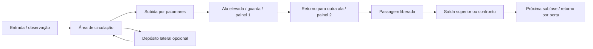

# Padrão de fases exploratórias — revisão 18

## 1. Problema e objetivo

O teste do usuário mostrou que avançar quase sempre para a direita bastava para atravessar os setores. O catálogo tinha plataformas altas, salas com recursos e retornos entre subfases, mas o percurso principal ficava no piso inferior. Os testes anteriores de corredor aceitavam essa solução; ter geometria vertical opcional não garantia exploração.

A prioridade mudou: **estrutura e exploração antes das próximas músicas**. A campanha continua com oito fases e 26 setores. Nesta revisão, os **23 setores fora do trem** passam a exigir exploração elevada e retorno; os três do trem preservam o percurso mais linear e os desafios de travessia já existentes.

## 2. Padrão adotado

| Momento | Função no percurso | Implementação atual |
| --- | --- | --- |
| Entrada e observação | Mostrar uma passagem bloqueada e indicar um destino fora do piso inferior | Objetivo textual com direção relativa; tutorial de CIMA no primeiro setor |
| Aproximação e subida | Fazer o jogador mudar de altura e escolher apoios | Plataformas, patamares adicionais e salas cobertas com entradas laterais |
| Ala distante | Exigir alcançar e verificar um lugar | Painel primário em uma sala elevada; um guarda próprio protege o comando |
| Retorno | Mudar a direção do percurso e utilizar outra ala | O primeiro painel envia sinal ao segundo, colocado à esquerda; voltar é obrigatório |
| Liberação | Recompensar a inspeção com acesso persistente | Segundo painel abre um portão sólido; libera saída superior ou acesso ao confronto |
| Desvio opcional | Permitir procurar recursos além do objetivo principal | Objetos e baús existentes; seis depósitos laterais novos, fora da sequência de comandos |
| Avanço e revisita | Conectar subfases e facilitar exploração posterior | Portas bidirecionais, checkpoints reposicionados e comandos/portões que permanecem resolvidos |

Os painéis funcionam como a primeira implementação de um **contrato de percurso**. A tabela autoral já diferencia posições, alturas, salas, acessos e depósitos. Nas próximas revisões de autoria, o papel de cada comando pode virar mecanismo ambiental mais próprio do setor: comporta, antena, elevador, circuito ou arquivo. Não é necessário mudar o motor para diversificar esses encontros.

### 2.1 Regras obrigatórias

1. Segurar direita não pode concluir o setor exploratório.
2. A rota principal exige sair do piso inferior e retornar a outra ala. Os lugares obrigatórios não podem ser apenas cenários decorativos.
3. Ren, Maya e Leon precisam conseguir percorrer ida e retorno sem voo, item JMP, resgate ou dano para atravessar perigos. O voo da Maya pode ajudar na locomoção, preservando a necessidade de examinar os lugares.
4. O guarda do painel é um encontro específico. Não é necessário matar todo inimigo do mapa; inimigos comuns continuam podendo ser evitados e reaparecer conforme as regras anteriores.
5. Uma passagem ainda depende dos comandos mesmo se o jogador alcançar o outro lado do portão por salto/voo. Um chefe não começa antes da exploração e da regra de arena correspondente.
6. Morte, retorno ao setor e carregamento conservam os comandos resolvidos. O guarda obrigatório não reaparece para fechar a rota. Plataformas essenciais de controle são permanentes.
7. Recursos opcionais não ativam painéis nem abrem a saída. O jogador escolhe o risco de procurar o baú e mantém a recompensa por exploração.
8. Os objetivos têm nome no mundo e indicação relativa no HUD; CIMA serve para examinar e atravessar portas. A interface não revela pontos ou limiares de vidas.

### 2.2 Exceções e variação

- **2A–2C / trem:** fluxo predominante para a frente, com saltos, vãos, serviço, obstáculos e chefe. Continua sendo uma exceção identificada, não o molde da campanha inteira.
- **3B / guindastes e 8C / elevador orbital:** a progressão longa continua vertical. Há retorno lateral no alto; não é exigido descer mil unidades só para apertar um painel.
- **Setores finais:** a dupla de comandos libera o acesso ao confronto. As arenas e seus sobreviventes conservam a regra de encontro obrigatório; o chefe continua apenas no último setor.
- **Revisitas:** depois de liberada, a passagem permanece aberta. Os retornos entre setores não exigem repetir o circuito.

## 3. Exemplo de leitura: 1A

Em **Fuga do Laboratório**, o jogador sobe até o **Arquivo de contenção**, vence o guarda e examina o painel. O sinal habilita o **Comando de manutenção**, em outra plataforma à esquerda. Depois do retorno, o portão abre e a saída para os telhados fica na plataforma superior, em vez de no fim do piso inferior.

Um depósito elevado na lateral esquerda guarda o baú; são necessários saltos próprios para visitá-lo, e abrir esse baú não substitui a exploração obrigatória. As salas usam pisos e tetos sólidos com acesso lateral, permitindo trajetos e abordagens diferentes conforme o personagem.

Mapas exportados diretamente do catálogo:

- [1A — laboratório e depósito lateral](mapas/1A.svg)
- [4B — esteiras, controles elevados e passagem superior](mapas/4B.svg)
- [8C — ascensão orbital com retorno no alto](mapas/8C.svg)

As linhas dos mapas indicam a ordem dos objetivos. Para atualizar os SVG depois de mexer nos dados, executar `./node_modules/.bin/tsx scripts/export-route-maps.ts` na raiz.

## 4. Aplicação nos setores

| Setor | Primeira ala | Ala de retorno |
| --- | --- | --- |
| 1A | Arquivo de contenção | Comando de manutenção |
| 1B | Antena leste | Relé da cobertura oeste |
| 1C | Bomba do reservatório | Válvula de retorno |
| 1D | Posto de vigilância | Comando do bloqueio |
| 3A | Controle de carga | Oficina de fundação |
| 3B | Cabine do guindaste | Relé lateral das vigas |
| 3C | Controle de tempestade | Abrigo do heliponto |
| 4A | Comando dos tanques | Sala de refrigeração |
| 4B | Distribuidor de energia | Controle de alimentação |
| 4C | Comando do reator | Válvula de descarte |
| 5A | Sala de credenciais | Recepção de segurança |
| 5B | Servidor da garagem | Oficina de serviço |
| 5C | Arquivo executivo | Comando do cofre |
| 6A | Arquivo holográfico | Sala de projeção |
| 6B | Núcleo de irrigação | Controle do jardim oeste |
| 6C | Catálogo restrito | Controle do acervo |
| 7A | Central da doca | Posto de vigilância |
| 7B | Servidor de contenção | Comando de acesso |
| 7C | Sala de comunicações | Comando de autorização |
| 8A | Distribuidor da torre | Comando da base |
| 8B | Estabilizador Zero | Controle de retorno |
| 8C | Comando orbital | Relé lateral do eixo |
| 8D | Autorização estratosférica | Comando da plataforma |

Foram adicionados apoios nos caminhos que antes eram opcionais ou dependiam de movimento muito preciso. Os depósitos de **1A/3A/4A/5A/7A/8A** recebem caminhos laterais próprios e reutilizam os baús/recompensas existentes. Não foram adicionadas vidas infinitas por ativar painéis. A campanha tem **155 inimigos inicialmente ativos**, incluindo 23 guardas de comando, e duas origens dormentes de torretas; conserva 77 checkpoints e 78 objetos. São 23 portões e 382 peças de terreno no catálogo atual.

## 5. Contrato técnico

- `campaign/exploration.ts`: tabela de rotas por setor e montagem determinística dos apoios, salas, depósitos, saída e portão sobre os mapas existentes. Sem aleatoriedade; cada posição é autoral e faz parte do catálogo validado.
- `SubstageDefinition.exploration`: estilo `loop`/`vertical` e nós com ID, nome, corpo de interação, dependências e índice do guarda. Capítulo 2 não recebe esse contrato.
- `GameEngine.inspectRouteNode()`: verifica proximidade, ação permitida, sinal anterior e guarda vivo; ativa somente depois das condições. O mesmo método atende o CIMA de teclado, toque e gamepad.
- `routeComplete()`: autoriza a saída dianteira e o gatilho de chefe. Portas de retorno continuam disponíveis conforme as regras de combate/arena.
- `Platform.gateId`: identifica portão físico. A resolução do circuito marca `broken`, retirando o sólido de movimento, visão e tiros; o portão nunca fecha novamente na tentativa atual.
- `Enemy.requiredGuard`: torna o guarda do comando não repetível no SpawnManager. O histórico e as recompensas dos inimigos comuns continuam como antes.
- `activated`: lista de comandos no cache e save corrente. O codec valida IDs, dependências, guarda já ausente e coerência de portões abertos; a restauração não inventa progresso.
- O validador de autoria rejeita comandos sem piso permanente, corpos dentro do terreno, IDs/dependências inválidos, ciclos e guardas desconhecidos.

O formato de save foi ajustado para o estado corrente, sem migrações ou obrigação de preservar versões antigas, conforme orientação do usuário. A troca livre de personagem permanece ferramenta de teste; a regra final de troca no continue não foi modificada.

## 6. Evidência e aceite

**378 testes passaram**, além de TypeScript, build web, build dos assets Android e sync. A contagem reflete a substituição dos antigos ensaios de corredor pelos percursos novos:

- **69 percursos de exploração**: dois comandos e saída/confronto dos 23 setores com os três heróis.
- **69 percursos de retorno**: do último checkpoint ao acesso anterior/entrada com os três heróis.
- **18 percursos de depósito opcional**: seis depósitos com os três heróis, abrindo o baú sem resolver o circuito.
- O trem conserva seus ensaios de ida/retorno. Há regressões de simplesmente caminhar, voo sobre o bloqueio, sinal/guarda, interação por tick, repetição, morte, revisita, save, dependências e portões adulterados.

O planejador de ensaio procura comandos com a física real do motor e depois reproduz a solução por movimento/salto/descida de cano, sem editar coordenadas durante o percurso aceito. Combate é isolado nesses ensaios. Plataformas móveis opcionais são removidas da simulação de aceite para provar que não são assistência obrigatória; contatos com ácido/laser são rejeitados mesmo quando o laser estaria apagado. Isso não certifica dificuldade com todos os inimigos ativos, timing de plataformas móveis ou vitória manual da campanha inteira.

Chromium horizontal 915×412: segurar direita não resolve o setor; alcançar a porta bloqueada não muda de mapa; CIMA exige vencer o guarda; golpes reais e CIMA por toque liberam os comandos; a passagem e o retorno persistem depois de recarregar. As posições de combate/inspeção foram preparadas no ensaio; não equivalem ao percurso manual completo. Sem erro JavaScript.

**Músicas permanecem pausadas como trabalho de produção.** Próximos ajustes deste bloco são avaliação no celular, clareza dos acessos e densidade/dificuldade dos encontros, além de diversificar os mecanismos ambientais conforme cada setor. Nenhuma Action foi acionada e nenhum APK foi gerado. Multiplayer e migração de engine continuam futuros.
