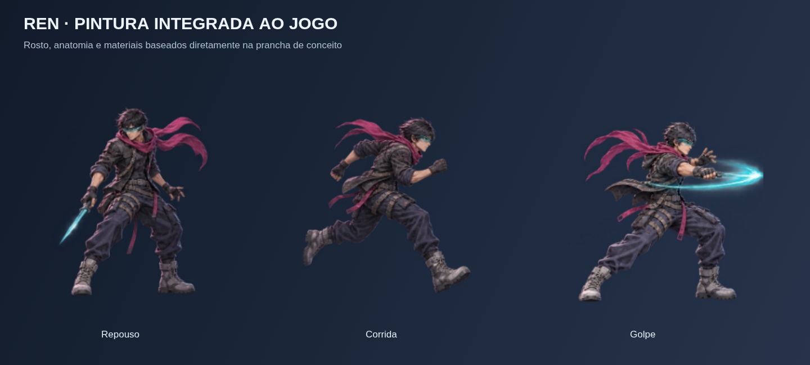

# Ren pintado — incremento 24

## 1. Objetivo e entrega

O usuário pediu aproximar a imagem jogável da prancha detalhada, trabalhando em um personagem por vez. Este lote concentra a produção no **Ren**: o renderer passa a usar pinturas baseadas diretamente na identidade da prancha, com rosto, cabelo, viseira estreita, anatomia humana, jaqueta/harness/fivelas, tecido, botas e cachecol detalhados. Maya, Leon, inimigos e chefes continuam na V2.



- [Folha de todos os estados do Ren](arte/ren-sheet.png).
- [Captura no jogo](arte/ren/jogo.png).
- [Atlas PNG para inspeção](arte/ren-atlas.png).
- [Manifesto de fontes, recortes e alinhamento](arte/ren/manifesto.json).

As imagens são os recursos usados pelo renderer, além da prancha de conceito já existente. Não se anuncia o desenho procedural como se tivesse o mesmo acabamento da pintura.

## 2. Produção e origem

Três folhas-fonte RGBA de 1536 × 1024, produzidas pela ferramenta de geração de imagens da OpenAI a partir da prancha original de MindBreak e da primeira folha do Ren:

1. [Locomoção](arte/ren/fontes/01-locomocao.png): repouso, três chaves de corrida, salto e queda.
2. [Combate](arte/ren/fontes/02-combate.png): três cortes, dash, slide e dano.
3. [Acrobacia](arte/ren/fontes/03-acrobacia.png): parede, escalada, hang, vault, especial e morte.

A folha de combate recebeu uma edição pela mesma ferramenta para manter botas/cachecol dentro de suas células. Não há repintura manual automática por remoção de fundo ou recorte de pessoas externas. Transparência real é mantida; a montagem recorta as margens das células para excluir guias/fragmentos, redimensiona e alinha as figuras.

O arquivo original permanece na pasta de imagens geradas do ambiente; as três fontes finais foram copiadas para o repositório, fora do bundle. O manifesto registra SHA-256 de fontes/asset, coordenadas, escala e alinhamento. A geração de pintura não é determinística; a montagem a partir dos PNGs preservados é reproduzível no mesmo browser/codec.

## 3. Quadros, anatomia e animação

São **18 pinturas-fonte**, distribuídas pelos **18 clipes e 55 posições lógicas** já existentes. Não são 55 pinturas exclusivas ou uma animação final com todos os intermediários.

| Clipe | Fonte usada |
|---|---|
| idle | Repouso mantido |
| run | Três chaves A/B/C, repetidas A/B/C nos seis slots |
| jump / fall | Salto / queda mantidos |
| wall | Parede |
| climb | Alternância entre parede e escalada |
| hang / vault | Hang / vault mantidos |
| dash / slide | Dash / slide próprios |
| attack1/2/3 | Corte próprio durante o trecho ativo; repouso na recuperação |
| hurt / stun | Reação a dano |
| special | Conjuração própria |
| flight | Queda como pose de autoria; Ren continua sem habilidade de voo |
| death | Ren deitado; o continue imediato ainda mantém a primeira pose |

As chaves são alinhadas com pivot/escala comuns, correções horizontais por pose e ajuste discreto de escala no finalizador. A qualidade de rosto/materiais foi priorizada neste lote. A próxima passagem do Ren deve melhorar os intermediários, transições de tronco/cachecol, consistência entre poses e locomoção, antes de usar esse acabamento como padrão concluído dos demais heróis.

## 4. Contrato com o motor

### 4.1 Geometria e tempo

- Atlas **2560 × 2240**, oito colunas, quadros **320 × 320** e um slot final vazio. Metadados do Ren em **versão 3**; V2 de Maya/Leon permanece 96 × 128.
- Pivot fonte `(160,288)`, escala de desenho **0,25**. O quad de 80 × 80 unidades de mundo contém transparência para cachecol, braços e arma; isso não aumenta o corpo atingível.
- Referência física `(96,64,128,224)` na fonte: largura/altura **32 × 56** e origem **(-16,-56)** relativa ao centro dos pés, exatamente como antes.
- `getHeroMetadata` e o desenho consultam o mesmo atlas carregado, evitando recortar a pintura com retângulos da V2. `heroAtlasMetadata` aceita definições por herói, preservando durações/eventos de `HERO_CLIPS`/`SWINGS`.
- Física, colisões, alcance, dano, velocidades, energia, progressão e regras de troca não mudaram. Pinturas de lâminas não criam eventos de dano. O relógio físico e as pausas de impacto continuam selecionando a pose.
- O cachecol geométrico antigo é ocultado quando a pintura está pronta, para evitar duplicação; continua disponível no fallback. O arco dinâmico normal do Ren usa ciano para combinar com a lâmina; berserk mantém vermelho. Avisos, reflexos e outras regras não mudam.

### 4.2 Carregamento e pacote

`renPainted.ts` carrega o WebP de forma assíncrona, verifica dimensões e o copia uma vez para o canvas do atlas. Calls repetidos compartilham a mesma Promise/cache. O renderer mantém o Ren procedural enquanto carrega ou se houver erro; falha de imagem não interrompe a simulação. Recarregar a página permite uma nova tentativa. Após o atlas pintado ficar disponível, a referência ao atlas procedural do Ren é descartada do cache.

Asset de produção: `src/assets/ren/ren-painted.webp`, **1.169.560 bytes** (aproximadamente 1,12 MiB), WebP com alpha e qualidade de exportação 0,97. PNGs de fonte e PNG documental não são empacotados. Vite dá hash ao nome do asset e Capacitor copia o resultado localmente.

O Workbox passou a incluir `.webp` no precache, dentro do limite padrão de 2 MiB por arquivo. O desenho funciona offline depois que a versão web terminou de instalar o cache; o Android usa o arquivo nos assets locais. A validação web não substitui teste de instalação/execução física Android.

Canvas do Ren: **21,875 MiB RGBA**, sem overhead. Com os dois heróis V2, inimigos e chefes totalmente aquecidos, o teto aritmético é aproximadamente **36,97 MiB** de pixels. Durante decode/cópia pode existir outra imagem decodificada do Ren, além de caches internos/GPU; liberar referência não garante coleta imediata. Medir o pico/primeiro carregamento no aparelho continua pendente.

## 5. Autoria e reprodução

Com Vite aberto, Playwright/Chromium disponíveis:

```bash
PREVIEW_URL=http://localhost:3000 \
PLAYWRIGHT_MODULE=/caminho/playwright/index.mjs \
CHROMIUM_PATH=/usr/bin/chromium \
node scripts/build-ren-artwork.mjs

# Após montar o arquivo, exportar as prévias e validar os rasters:
PREVIEW_URL=http://localhost:3000 \
PLAYWRIGHT_MODULE=/caminho/playwright/index.mjs \
CHROMIUM_PATH=/usr/bin/chromium \
node scripts/export-art-previews.mjs

PREVIEW_URL=http://localhost:3000 \
PLAYWRIGHT_MODULE=/caminho/playwright/index.mjs \
CHROMIUM_PATH=/usr/bin/chromium \
node scripts/check-art-renders.mjs
```

Variáveis de browser são opcionais quando instaladas no ambiente padrão. O primeiro comando usa `/tools/ren-atlas-builder.html` e gera o asset/manifesto. O estúdio `/tools/art-studio.html` aguarda o carregamento da pintura para exportar e usa dimensões/pivot do herói selecionado; a referência física pode ser sobreposta só na ferramenta.

As folhas de Maya/Leon tiveram somente o layout documental reorganizado pela ferramenta; suas fontes visuais/runtime continuam V2. Não há Action de autoria ou geração automática de APK.

## 6. Validação

**406 testes aprovados.** Novos testes: equivalência física de pivot/referência, todas as 55 posições com fonte real, cobertura das 18 pinturas, isolamento dos recortes, limites do atlas, alpha/dimensões/tamanho do WebP, loader seguro sem DOM e coerência entre metadata/readiness. Regressões de combate, física, campanha, áudio e entrada continuam aprovadas.

Chromium horizontal com touch: Ren pintado confirmado no renderer do motor, corrida/salto/golpe, pausa/hitstop e coexistência de Maya/Leon V2, sem erros JS. Estados e posições foram preparados para isolar o ensaio; não é campanha completa vencida manualmente. O comando de autoria validou 285 recortes de todos os catálogos com cache e presença de desenho.

Teste de falha: requisição da pintura abortada, fallback V2 mantido, reload com requisição liberada recuperando Ren 320 × 320. Teste de produção PWA: WebP encontrado no precache; após limpar cache HTTP e desligar rede, página recarregou e o asset foi obtido/decodificado offline com 2560 × 2240 e tamanho correto. Sem erros JS.

TypeScript, build web, build de assets Android e sync aprovados; asset conferido dentro dos assets Android. Nenhuma Action executada ou APK gerado. Pendentes: acabamento dos intermediários, playtest/legibilidade na escala do celular, anatomia/consistência entre chaves e profiling físico de memória/FPS. O foco seguinte continua sendo refinar o Ren neste padrão antes de produzir Maya/Leon com a mesma qualidade.
